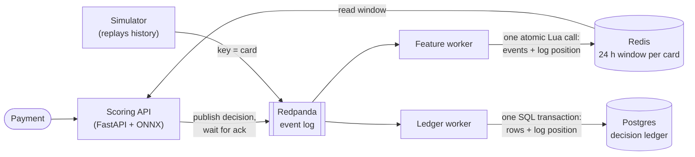

# Finspeq

**A real-time card-fraud pipeline that gives the same answer every time you replay it.**

Feed it the same stream of card transactions twice and you get the same features and the same
decisions, down to the last byte. That holds when workers crash mid-batch, when Redis is killed,
and when events arrive late, twice, or out of order. Finspeq exists to prove that claim with
measurements, not to assert it.


---

## The results

Every number below comes from runs on one machine: Intel Core i7, 32 GB RAM, Windows, with Redpanda,
Redis and Postgres in Docker Desktop. The raw reports are in [`notes/`](notes/).

| What was tested | Result |
|---|---|
| Fraud model on 2.5 M unseen transactions | Catches **93.8%** of fraud while flagging **0.5%** of legitimate payments |
| Model exported to ONNX vs the original | **0** decisions changed out of 2.5 M; single-call p99 **0.18 ms** |
| Live stream vs in-memory replay, 115,720 events | **0** differences in any card's window |
| 108 hard crashes of the feature worker (`kill -9` style) | **0** differences; the naive approach over-counted **4.93%** ($353k) |
| Redis killed mid-run, then a full rebuild from offset 0 | **0** differences; rebuild at **9,845** events/s |
| Events delayed by up to 24 h, plus 1% duplicates, with 109 crashes | **0** differences against a replay of the same arrival order |
| 8 workers on 8 partitions, rebalances, a stalled "zombie" worker | **0** differences; up to **24,063** events/s on one machine |
| Publishing without a key | Final state still matches, but **67%** of features are wrong when scored |
| Scoring API at 100 requests/s, decision logged before answering | p50 **7.4 ms**, p99 **39 ms** |
| Decision ledger through 42 crashes and a Postgres SIGKILL | **124,146** rows, **0** missing, **0** duplicates |
| Broker stopped for 10 s at 200 requests/s | **80** requests refused (503), **0** decisions returned without a log entry |
| Relay crashed 10 times: plain commits vs Kafka transactions | **2,000** duplicate records vs **0** for `read_committed` readers |
| Shadow model on 90,000 live requests | **99.65%** same decisions; costs one extra predict (**1.7 ms** p50) |
| Live feature vectors vs offline ones for the same events | **15.4%** differ under replay-speed load; the drift monitor flags them, the offline data does not |
| Chargebacks arriving 7–60 days late | Recall seen on the labels so far stays within **1.8** points of the true recall |

## The idea in one picture



The event log is the only source of truth. The API's only write is to the log, and it answers
only after the broker confirms it. Redis and Postgres are derived from the log and can be thrown
away and rebuilt. Each worker stores how far it has read **in the same atomic step** as the data
it wrote, so a crash can never leave the two out of step. That one rule is what makes replays
exact.

## Why build this

Most fraud demos stop at a model in a notebook. In a real payment system, the hard part is the
part around the model: a card's history must be up to date when the next payment arrives, and it
must stay correct when machines fail. Finspeq is a from-scratch study of that part. There is no
stream-processing framework: the consumer loop, the atomic store, the crash drills and the replay
harness are all written by hand, so every guarantee is visible in the code.

## Quickstart

You need Python 3.11+, Docker, and the
[Sparkov](https://github.com/namebrandon/Sparkov_Data_Generation) credit-card dataset as
`data/raw/combined_transactions.csv`.

```bash
python3.11 -m venv .venv && source .venv/bin/activate   # Windows: .venv\Scripts\activate
python -m pip install -e ".[dev,data,training,streaming]"
python scripts/ci.py                                     # format, lint, types, layers, tests

python scripts/convert_csv_to_parquet.py                 # CSV -> Parquet, PII columns dropped
python scripts/sort_events.py                            # one canonical event order

docker compose up -d                                     # Redpanda, Redis, Postgres
finspeq-stream simulate --from-date 2026-03-01 --to-date 2026-06-15 --slice 20:0
finspeq-stream worker --idle-exit-s 10
finspeq-stream verify-state --from-date 2026-03-01 --to-date 2026-06-15 --slice 20:0
```

The last command replays the same events in memory and compares every card's window with what
the worker wrote to Redis. It should report `"window_mismatches": 0`.

<details>
<summary><b>Train the model (M0)</b></summary>

```bash
finspeq-offline build-dataset --feature-set v2 --jobs 8
finspeq-offline baselines
finspeq-offline train --name v2-none --threads 8
finspeq-offline export --candidate-dir models/candidates/v2-none --threads 8
```

</details>

<details>
<summary><b>Run the scoring API and the ledger (M5)</b></summary>

```bash
python -m pip install -e ".[serving]"
finspeq-serve --model-dir models/<version> --port 18000
curl -s localhost:18000/readyz
finspeq-stream ledger --idle-exit-s 10      # copy logged decisions into Postgres
finspeq-stream verify-ledger                # compare the ledger with the log
```

</details>

<details>
<summary><b>Monitoring: drift, a shadow model, dashboards (M6)</b></summary>

```bash
finspeq-offline drift                                # PSI per feature and month vs TRAIN
finspeq-offline delayed-labels --model-dir models/<version>
finspeq-serve --model-dir models/<live> --shadow-model-dir models/<candidate> --port 18000
finspeq-stream shadow-report                         # live vs shadow decisions, with labels
finspeq-stream drift-ledger                          # daily PSI of the recorded vectors
docker compose --profile observability up -d         # Prometheus :9090, Grafana :3000
python scripts/compare_evidently.py --output notes/m6/evidently_compare.json  # needs .[evidently]
```

</details>

<details>
<summary><b>Run the crash, disorder, scaling, hot-path and operations drills (M2 to M6)</b></summary>

```bash
bash scripts/m2_drills.sh    # crashes, naive counter, Redis kill, full rebuild
bash scripts/m3_drills.sh    # delayed and duplicated events, lateness sweep
bash scripts/m4_drills.sh    # partitions, workers, rebalances, zombie, live load
bash scripts/m5_drills.sh    # latency, the race, broker down, ledger under crashes
bash scripts/m6_drills.sh    # drift, delayed labels, shadow, Kafka transactions, Grafana
bash scripts/m6_lag_check.sh # consumer-lag gauge vs an independent lag measurement
```

Reports land in `notes/m2/` to `notes/m6/`.

</details>

## How it works

1. **One order for everything.** Every transaction has a canonical position: event time, then
   transaction id. Training data, replays and checks all use it, so "the same input" has one
   meaning.
2. **Features are plain Python.** Eleven features (counts, spend, ratios, distance, time since
   last purchase) are computed from a card's last 24 hours by the same code offline and online.
   Redis only stores raw events; it never computes anything.
3. **Writes are atomic and idempotent.** One Lua script per batch validates everything, skips
   offsets it has already applied, rejects gaps, ignores duplicate transaction ids, prunes old
   entries and saves the log position, all as one step.
4. **Recovery reads the store, not Kafka.** After a crash the worker resumes from the position in
   Redis. Kafka's own committed offset lagged by up to 150 events in the drills; trusting it would
   double-count.
5. **Ownership doesn't matter for correctness.** Several workers share the partitions; after
   a rebalance or a stalled worker's late write, the position check makes repeats no-ops
   ([ADR-012](docs/adr/012-partitioning-and-assignment.md)).
6. **No decision without a log entry.** The API publishes the payment and its decision, waits
   for the broker, then answers. If the broker is down it answers 503
   ([ADR-014](docs/adr/014-broker-down-returns-503.md)). The window it reads may miss a
   same-card payment from the last half second; that is measured and accepted
   ([ADR-013](docs/adr/013-single-writer-and-measured-staleness.md)).
7. **Late events are welcome.** Entries are kept for 24 h plus one hour of allowed lateness, and
   late events are applied, never dropped ([ADR-011](docs/adr/011-allowed-lateness.md)).
8. **Drift is checked against a replay.** PSI per feature flags changes; because every event can
   be recomputed offline, a live alert is compared with the offline features of the same events
   to tell real drift from a serving bug
   ([ADR-017](docs/adr/017-drift-checked-against-offline-vectors.md)).

The full story, with the reasoning behind each choice, is in the
**[project write-up](docs/WRITEUP.md)**.

## Milestones

| | Milestone | What it proves | Status |
|---|---|---|---|
| M0 | Offline model | A deterministic dataset and a model that survives export | Done |
| M1 | One partition, one worker | The live store equals a replay | Done |
| M2 | Crashes | "Effectively once" under 100+ hard crashes | Done |
| M3 | Disorder and lateness | Exact replays with late and duplicate events; lateness chosen from data | Done |
| M4 | Scaling out | Exact state through rebalances and zombies; why the key matters | Done |
| M5 | Hot path | Logged decisions in milliseconds, an exact ledger, the race measured | Done |
| M6 | Operations | Drift vs skew, delayed labels, a shadow model, Kafka transactions, Grafana | Done |

## Project layout

```
finspeq/
  domain/        value objects, card windows, features, decision policy (standard library only)
  application/   ports (typing.Protocol), messages, use cases
  adapters/      inbound: HTTP API, CLIs, consumer loop, fault injection
                 outbound: Redis + Lua, Redpanda, Postgres, Parquet, LightGBM, ONNX, Prometheus
  bootstrap/     one composition root per process: offline.py, streaming.py, serving.py
tests/           unit, contract (one suite per port, run against every adapter), integration
scripts/         CI, data preparation, crash drills
experiments/     the naive counter (M2) and the Kafka-transactions relay (M6)
infra/           Postgres schema, Prometheus config, provisioned Grafana dashboard
docs/adr/        seventeen architecture decision records
notes/           results of every milestone, with raw JSON reports
```

The dependency rule (domain ← application ← adapters ← bootstrap) is enforced by
`import-linter`, not by convention.

## Engineering rules

- Hexagonal architecture: the core imports no third-party package, and every port has a contract
  suite that each adapter must pass.
- `mypy --strict`, `ruff` with docstring, naming and complexity rules, lines of at most 100
  characters, every module, class and function documented.
- Determinism by construction: integer cents for money, event time only, seeded randomness, LF
  line endings, content-hashed datasets and models.
- `python scripts/ci.py` runs format, lint, types, layer contracts, line length and about 270
  tests. See [CODING_STANDARDS.md](CODING_STANDARDS.md).

## Read more

| Document | What is in it |
|---|---|
| [docs/WRITEUP.md](docs/WRITEUP.md) | The whole project, section by section, for engineers and non-engineers |
| [DESIGN.md](DESIGN.md) | Goals, the core invariant, data profile, milestone plan |
| [ARCHITECTURE.md](ARCHITECTURE.md) | Hexagonal design, SOLID, ACID analysis, failure modes |
| [docs/adr/](docs/adr/) | Every significant decision, with context and consequences |
| [notes/](notes/) | Measured results of M0 to M6 |

## Data

Finspeq uses a synthetic credit-card dataset produced with
[Sparkov](https://github.com/namebrandon/Sparkov_Data_Generation): 12.5 million transactions on
9,970 cards over 18 months, 0.75% fraud. No real cardholder data is involved, and the conversion
step drops the generated names, SSNs and street addresses anyway. `data/` and `models/` are not
committed.
