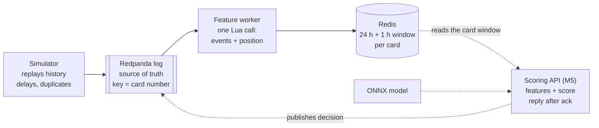

# Finspeq: a real-time fraud pipeline that replays exactly

A section-by-section account of the project, written for engineers and for readers who are new
to streaming systems. Each section opens with a plain-language summary, then goes into detail.

**Contents**

1. [In one page](#1-in-one-page)
2. [The problem: fraud scoring on a moving stream](#2-the-problem-fraud-scoring-on-a-moving-stream)
3. [M0: the data and the model](#3-m0-the-data-and-the-model)
4. [The architecture](#4-the-architecture)
5. [The window store: one atomic step per batch](#5-the-window-store-one-atomic-step-per-batch)
6. [M1: proving the live store equals a replay](#6-m1-proving-the-live-store-equals-a-replay)
7. [M2: crashes and "effectively once"](#7-m2-crashes-and-effectively-once)
8. [M3: late events and choosing allowed lateness](#8-m3-late-events-and-choosing-allowed-lateness)
9. [M4: several workers, rebalances and the key](#9-m4-several-workers-rebalances-and-the-key)
10. [Engineering standards](#10-engineering-standards)
11. [What comes next, and what we learned](#11-what-comes-next-and-what-we-learned)
12. [Glossary](#12-glossary)

---

## 1. In one page

Finspeq scores card payments for fraud as they stream in, and it is built so that replaying the
same stream always gives the same answer, byte for byte. Five milestones (M0 to M4) are done, and
every guarantee below was measured on one laptop.

> **In plain terms.** Imagine a bank's fraud checker that keeps a running notebook for each card:
> what it bought in the last 24 hours, where, and for how much. Every new payment is judged
> against that notebook. Finspeq is about keeping the notebook exactly right when the computers
> writing it crash, restart, fall behind, or receive pages out of order.

**The one promise (the core invariant).** Feeding the same event log through the system gives
exactly the same feature state and decisions every time, even if a worker crashes, restarts,
falls behind, or is split across more consumers.

| What was tested | Result |
|---|---|
| Fraud model on 2.5 M unseen transactions | Catches 93.8% of fraud while flagging 0.5% of legitimate payments |
| Model exported to ONNX vs the original | 0 of 2.5 M decisions changed; single-call p99 latency 0.18 ms |
| Live stream vs in-memory replay, 115,720 events | 0 differences in any card's window |
| 108 hard crashes of the feature worker | 0 differences; a naive counter over-counted 4.93% ($353,039) |
| Redis killed mid-run, then a full rebuild from the start of the log | 0 differences; rebuild at 9,845 events/s |
| Events delayed up to 24 h plus 1% duplicates, with 109 crashes | 0 differences against a replay of the same arrival order |
| 8 workers on 8 partitions, rebalances, a stalled "zombie" worker | 0 differences; up to 24,063 events/s |

**What it is built from.** Python 3.11, Redpanda (a Kafka-compatible event log), Redis, Postgres,
LightGBM exported to ONNX, and Docker Compose. There is no stream-processing framework: the
consumer loop, the atomic store, the crash drills and the replay checker are written by hand so
every guarantee is visible in code. The package is about 5,400 lines, with 2,600 lines of tests.

## 2. The problem: fraud scoring on a moving stream

The model is the easy part; keeping each card's recent history correct under failure is the hard
part, and it is what Finspeq studies.

> **In plain terms.** To decide whether a payment is suspicious, the system needs context: has
> this card made 12 purchases in the last hour, or none for a week? That context changes with
> every payment, across thousands of cards at once, on machines that can crash at any moment.

A real-time scorer has to answer four questions for every payment, within milliseconds:

1. **What has this card done recently?** Counts, spend and merchants over the last hour and day.
2. **Is that history complete?** A payment that arrives late, or twice, must not distort it.
3. **Does the score match what the model was trained on?** Features computed one way in training
   and another way live silently ruin a model.
4. **What happens after a crash?** A worker that dies halfway through a batch must neither lose
   nor repeat work.

**Why streams make this hard.** Messaging systems such as Kafka deliver each message *at least
once*. After a crash, the consumer resumes from its last saved position and re-reads anything
processed after it. A naive counter that adds +1 per message therefore counts some payments twice.
Events also arrive in *processing order*, which is not always *event order*: a terminal that was
offline uploads its payments hours later.

**The approach.** Every milestone follows the same loop: learn a concept, break the invariant on
purpose, fix it, and prove the fix with a replay check that compares the live system with an
in-memory reference. A guarantee only counts once a measurement shows it.

## 3. M0: the data and the model

A LightGBM model on 11 hand-written features catches 93.8% of fraud at a 0.5% false-alarm rate on
four unseen months, and its ONNX export changes none of 2.5 million decisions.

> **In plain terms.** Before streaming anything, we needed a fair judge. We trained a model on
> 2025 data, tuned its alarm levels on early 2026, and tested it on spring 2026, which it never
> saw.

### The dataset

The data is synthetic, produced with the
[Sparkov](https://github.com/namebrandon/Sparkov_Data_Generation) generator: 12,553,594
transactions on 9,970 cards from January 2025 to June 2026, of which 0.75% are fraud. No real
person is involved; the conversion step still drops the generated names, SSNs and street
addresses. All 10 data-quality checks pass ([report](../notes/data_quality.md)).

| Split | Period | Rows | Fraud rate |
|---|---|---|---|
| Train | 2024-12-31 to 2025-12 | 9,060,290 | 0.72% |
| Valid | 2026-01 to 2026-02 | 996,572 | 1.07% |
| Test | 2026-03 to 2026-06-14 | 2,496,732 | 0.72% |

Every transaction gets one canonical position: event time, then transaction id. The sorted file
is hashed, and sorting it on Linux and on Windows gave the same SHA-256. Datasets built twice are
byte-identical, and a model trained twice gets the same version id.

### The features

A feature is a number the model looks at. All 11 are computed from the transaction and its card's
last 24 hours, by the same Python code offline and online.

| Feature | What it measures |
|---|---|
| `amount_dollars` | The payment amount |
| `tx_count_1h`, `tx_count_24h` | How many payments the card made in the last hour and day |
| `spend_1h`, `spend_24h` | How much it spent in the last hour and day |
| `amount_to_mean_24h` | This amount compared with the card's average today |
| `amount_to_max_24h` | This amount compared with the card's largest payment today |
| `secs_since_last` | Seconds since the card's previous payment |
| `distinct_merchants_24h` | How many different shops the card used today |
| `hour_of_day_utc` | The hour of the payment |
| `home_merchant_km` | Distance between the cardholder's home and the shop |

### The trap we found: category and time

The first feature set included the merchant category. The model put 88% of its weight on it and
looked excellent, until a test on a different month flagged 20.2% of legitimate payments at a
threshold meant to flag 1%. The cause: in this dataset, legitimate shopping moves between
categories in blocks of time, while fraud always uses the same four. The model had learned the
calendar, not fraud. Dropping the category and adding `amount_to_max_24h` brought that test back
to 1.03% ([ADR-009](adr/009-drop-category-feature.md)).

### Model choice and thresholds

LightGBM with no class reweighting beat a hand-written rule (PR-AUC 0.383), logistic regression
(0.419) and two reweighted LightGBM variants (0.920 and 0.914, against 0.927). Reweighting only
rescales probabilities, and thresholds are set from false-alarm budgets anyway, so it costs
ranking quality for nothing.

There are three decisions: approve, review, or block. Thresholds were chosen on the validation
months only, from false-positive budgets.

| Decision | Threshold | Budget (valid) | Test false-positive rate | Test recall | Test precision |
|---|---|---|---|---|---|
| Review | 0.04118 | 1% | 0.512% | 0.938 | 0.571 |
| Block | 0.46092 | 0.1% | 0.047% | 0.811 | 0.926 |

At the block threshold, the test months block 14,619 of 18,018 frauds and 1,168 of 2,478,714
legitimate payments.

### Exporting to ONNX without changing a decision

The model runs in production through ONNX Runtime. The first export differed from LightGBM by up
to 0.039 on 40 test rows. The cause: LightGBM stores split thresholds as 64-bit floats and ONNX as
32-bit floats rounded to nearest, and 28,963 of 85,064 thresholds rounded up. Amounts are whole
cents, so real values landed exactly on those thresholds and took the other branch. The fix
rewrites every threshold to the largest 32-bit float not above it, which keeps every split
decision exact. After the fix: maximum difference 1.2e-6, zero decision changes on 2,496,732 rows,
and single-call latency p50 0.13 ms, p99 0.18 ms. Full results: [notes/m0.md](../notes/m0.md).

## 4. The architecture

The event log is the only source of truth; Redis and Postgres hold copies derived from it, and the
code is arranged in four rings so the business rules never depend on any database or library.

> **In plain terms.** Think of a ledger book kept in a safe (the event log) and photocopies of it
> on people's desks (Redis, Postgres). If a photocopy is lost or smudged, you make a new one from
> the book. You never edit a copy and hope the book catches up.

### The data path

Solid lines are built (M0 to M4); dashed lines are planned for M5.

1. A **simulator** replays history into the log in canonical order. It can delay and duplicate
   events on purpose, with a seed so the same disorder can be produced again.
2. **Redpanda** stores each event in the `transactions` topic, keyed by card number, so all of a
   card's events land in one partition and keep their order. Acknowledgement waits for the disk
   (`acks=all`, `write.caching=false`).
3. The **feature worker** reads batches, writes them to Redis in one atomic step together with its
   read position, and records metrics.
4. **Redis** holds each card's last 24 hours plus one hour of allowed lateness.
5. Planned for M5: a **scoring API** reads a card's window, computes features, calls the ONNX
   model, and publishes the payment and decision to the log before answering. A ledger worker
   will copy decisions into **Postgres**.

Why publish to the log before answering, instead of writing to Redis, Postgres and the log
separately? Three separate writes can half-succeed and disagree. One write to the log is atomic by
construction, and every other store is rebuilt from it
([ADR-002](adr/002-synchronous-scoring-log-as-single-write.md)). The cost is a few milliseconds of
broker acknowledgement on the hot path.

### Hexagonal rings (ports and adapters)

| Ring | Holds | May import |
|---|---|---|
| Domain | Value objects (card id, money in integer cents, event time), card windows, the 11 features, the decision policy | Python standard library only |
| Application | Ports (interfaces written as `typing.Protocol`), messages, use cases such as `ApplyEvents`, `VerifyReplay`, `LatenessSweep` | Domain |
| Adapters | Inbound: command-line tools, the feature worker, fault injection. Outbound: Redis with Lua, Redpanda, Parquet, LightGBM, ONNX, Prometheus | Application, domain, third-party libraries |
| Bootstrap | One composition root per process: `offline.py` and `streaming.py` | Everything; wires adapters into use cases |

These rules are checked by `import-linter` on every CI run, through three contracts: the rings, a
core that imports no third-party package, and inbound and outbound adapters that never import
each other.

A **port** is a small interface the core needs, such as `WindowStore` (read a card's window, apply
a batch atomically) or `EventSource` (poll, seek, acknowledge). An **adapter** implements a port
with a real technology. Every port has a contract test suite, and every adapter must pass it: the
in-memory window store, fakeredis and a live Redis run the same 14 clauses, including a randomized
comparison against the memory store.

Each process has its own **composition root**, so the offline tools never load Kafka or Redis,
and the streaming worker never loads LightGBM. A test imports each root alone and checks which
libraries appear.

### SOLID and ACID, briefly

- **Single responsibility:** a use case does one job; for example, `ApplyEvents` applies and
  measures, and never reads Kafka.
- **Open/closed and Liskov:** a new store is a new adapter that passes the existing contract
  suite; no use case changes.
- **Interface segregation:** readers and writers are separate ports, so a scorer cannot write.
- **Dependency inversion:** the core owns the interfaces and adapters depend on them.
- **Atomicity:** one Lua script per batch, validation before the first write.
- **Consistency:** invariants live in constructors (money is positive, windows are ordered) and
  in the script (no offset gaps).
- **Isolation:** one writer per card, because one consumer owns each partition.
- **Durability:** the log is durable; Redis durability only shortens recovery, because positions
  roll back with the data.

The full analysis is in [ARCHITECTURE.md](../ARCHITECTURE.md).

## 5. The window store: one atomic step per batch

Each batch of events is written to Redis by one Lua script that also saves the log position, so
data and position can never disagree; this one rule carries most of the project's guarantees.

> **In plain terms.** A bookmark is only useful if it moves at the same moment you read the page.
> If you read three pages and then drop the book before moving the bookmark, you read them again
> and think you read six. Finspeq writes the pages and moves the bookmark in a single motion that
> cannot be interrupted halfway.

### What Redis holds

| Key | Type | Holds |
|---|---|---|
| `fq:card:{card}:ev` | Sorted set | Transaction ids, scored by event time |
| `fq:card:{card}:tx` | Hash | Per transaction id: time, amount in cents, merchant |
| `fq:card:{card}:newest` | String | The newest event time seen for the card |
| `fq:pos:{topic}:{partition}` | String | The last applied log offset |

Redis stores raw events only. Feature math lives in the Python domain, so training and live
scoring cannot drift apart ([ADR-004](adr/004-feature-math-in-python-domain.md)). A window is read
in one script call, which gives one consistent snapshot in one network round trip.

### What one apply does

1. **Validate everything first.** Redis does not roll back a script that fails halfway, so the
   script checks every argument before its first write and returns an error if anything is wrong.
2. **Skip what is already applied.** Events at or below the stored offset are ignored. This is
   what makes redelivery harmless.
3. **Reject gaps.** The first new offset must be the stored offset plus one. A gap means lost
   data, so the whole batch is refused.
4. **Keep the first copy.** A transaction id already stored for its card is not written again, so
   duplicates in the log are harmless.
5. **Prune by event time.** Each touched card drops entries older than its newest event time
   minus 24 hours minus the allowed lateness.
6. **Save the position** in the same call.

The in-memory store implements the same rules and is the reference every check compares against.
A randomized test feeds both stores the same random batches and requires identical results.

### Why not trust Kafka's committed offset?

Kafka can remember a consumer group's position, but that commit is a separate write that can fail
independently of the Redis write. In the M2 drills, the committed group offset lagged the store's
position after every one of 108 crashes, by up to 150 events. Recovering from it would have
re-applied those events. Finspeq uses the group offset only to measure lag
([ADR-003](adr/003-positions-stored-with-state.md)).

## 6. M1: proving the live store equals a replay

On 115,720 events from 417 cards, the windows built by the real worker through Redpanda and Redis
matched an in-memory replay exactly, and the worker applied 9,739 events per second.

> **In plain terms.** We built the pipeline once with real infrastructure and once as a simple
> in-memory model, fed both the same history, and checked that every card's notebook came out
> identical.

### The test slice

Most runs use one fixed slice: cards whose hashed number falls in bucket 0 of 20, from 1 March to
15 June 2026. The bucket is computed from a SHA-256 of the card number, so the slice is the same
on every machine and every run.

### Two levels of checking

| Level | How it works | Result |
|---|---|---|
| A: store level, in one process | The same batches go to the memory store and to Redis. Before each delivery, every touched window is compared; every apply result and position too. Every 7th batch is delivered twice. | 132,220 window reads, 33 batches redelivered, 0 mismatches |
| B: system level | `simulate` publishes to Redpanda, a real worker applies to Redis, then `verify-state` replays the slice in memory and compares every card's final window | 115,720 events, 417 cards, 0 mismatches; stored offsets cover every event |

Level A is strict about timing: it compares state at every step, not just the end. Level B is
strict about reality: it uses the real broker, a real consumer group and a separate worker
process.

### Throughput

| Component | Rate |
|---|---|
| Feature worker, one process, 500-event batches | 9,739 events/s (target 2,000) |
| Simulator publishing with durable acknowledgements | 1,591 events/s |

The simulator is slower because each 500-event chunk waits for the broker to write it to disk.
That is a deliberate durability choice, measured in M2.

### Bugs that M1 surfaced

| Problem | Effect | Fix |
|---|---|---|
| Redis Lua returns `false`, not `nil`, for a missing key | The first batch failed inside the script | Explicit check, caught by the fakeredis contract run |
| Redpanda acknowledges before fsync by default | A broker crash could lose acknowledged events | Topic created with `write.caching=false` |
| The worker's idle timer started before it joined its group | It exited after processing nothing | Separate start timeout; the idle limit begins after the first event |
| The Kafka client tried IPv6 first for `localhost` | Two-second connection delays | Clients use `127.0.0.1` |

Full results: [notes/m1.md](../notes/m1.md).

## 7. M2: crashes and "effectively once"

Under the same random crashes, a naive counter over-counted 4.93% of events while Finspeq's worker
stayed exact across 108 crashes, a Redis kill and a rebuild from scratch.

> **In plain terms.** We pulled the plug on the worker over a hundred times, at the worst possible
> moment: right after it wrote its results and before it told Kafka it was done. A simple approach
> double-counted; ours did not.

### How crashes are injected

The worker has three seeded crash points: after reading a batch, after writing it, and after
acknowledging it. A crash calls `os._exit(137)`, which ends the process instantly. It skips
cleanup code and pending offset commits, like a power cut. An ordinary exception would not do: it
runs cleanup, which hides the bugs being tested. A supervisor script restarts the worker until it
exits cleanly, and after every exit records two numbers: the position stored in Redis and the
offset committed to Kafka. Consumers rejoin quickly thanks to a 6-second session timeout and a
static member id ([ADR-010](adr/010-crash-testing.md)).

### The naive counter versus the worker

The naive counter is deliberately wrong and kept outside the package: it increments a counter per
card, then commits the Kafka offset. Both ran with a 5% chance of crashing after each 50-event
batch.

| | Naive counter | Feature worker |
|---|---|---|
| Crashes | 114 | 108 |
| Events counted or applied | 121,420 of 115,720 | 115,720 of 115,720 |
| Over-count | 5,700 events (4.93%) | 0 |
| Money over-counted | $353,039.24 | $0 |
| Cards affected | 405 of 417 | 0 |

The naive over-count is exactly 114 crashes × 50 events: each crash re-counts the batch whose
commit never happened. The worker skips those events because its position was saved in the same
Lua call as the data.

### The drills

| Drill | Result |
|---|---|
| Kafka offset vs stored position after each crash | The Kafka offset lagged after all 108 crashes, by up to 150 events; recovery used the stored position |
| Redis killed with SIGKILL mid-run, restarted from its append-only file | Redis came back at offset 38,399; the worker resumed exactly there; 0 mismatches |
| Total loss: empty Redis, rebuild from offset 0 | 115,720 events in 11.8 s (9,845 events/s); 0 mismatches |
| Redis fsync on every write instead of every second | 9,885 events/s: no measurable cost at one write per 500-event batch |
| Broker acknowledgement after disk write instead of before | 1,599 vs 1,756 events/s: durability costs about 10% of publish throughput |

The Redis kill shows why the bookmark rule matters. Redis lost its last moments of data and the
matching position together, so the two rolled back as a pair and the worker simply re-applied
from the older position. Full results: [notes/m2.md](../notes/m2.md).

## 8. M3: late events and choosing allowed lateness

Out-of-order events never broke replay equality, and keeping one extra hour of history removes
most of the error that lateness can remove; the rest comes from events that simply have not
arrived yet.

> **In plain terms.** Sometimes a payment shows up hours after it happened, for example from a
> terminal that was offline. When it finally arrives, has the card's notebook already thrown away
> the older pages it needs? And how much does a late payment confuse the judgement of the payments
> around it?

### Two kinds of time

**Event time** is when the payment happened. **Processing time** is when the system sees it.
Features use event time only, so a payment's features do not depend on when it was processed. A
**watermark** tracks the newest event time seen so far; an event more than the **allowed
lateness** behind it is called late.

### Making disorder on purpose

The simulator can now delay events and send duplicates, from a seed so the same disorder can be
reproduced exactly. Each event is delayed with some probability by a random amount (an
exponential distribution with a cap), and sent twice with another probability. Two profiles were
tested on the 115,720-event slice:

| | Mild | Heavy |
|---|---|---|
| Events delayed | 10%, mean 5 min, cap 2 h | 20%, mean 1 h, cap 24 h |
| Duplicates | 1% (1,177 events) | 1% (1,144 events) |
| Behind the stream's newest time | 9,947 events | 22,435 events |
| Behind their own card's newest time | 269 events | 4,590 events |

The last two rows hold a lesson. Most events that look late against the whole stream are not late
for their own card, because one card's purchases are hours apart. Redis prunes per card, so only
card-late events can lose history.

### The lateness sweep

A new tool scores every event at the moment it arrives, reading the card's window before writing
the event, exactly as a live scorer would. It compares each feature vector and decision with the
in-order run, once for each allowed lateness: 0, 1 minute, 10 minutes, 1 hour and 6 hours.

There are two causes of error, and only one can be fixed by keeping more history:

1. **Pruned history.** A late event needs entries up to 24 hours before its own time, and those
   may already be pruned. More allowed lateness keeps them.
2. **Missing predecessors.** An earlier payment of the same card has not arrived yet. No amount of
   kept history helps; only waiting before scoring would.

| Allowed lateness | Extra history kept | Mild: vectors that differ | Heavy: vectors that differ | Heavy: frauds blocked (of 956) |
|---|---|---|---|---|
| 0 | 0% | 289 | 7,120 (6.15%) | 745 |
| 1 min | 0.1% | 289 | 7,108 | 745 |
| 10 min | 0.7% | 283 | 6,948 | 746 |
| 1 h | 4.2% | 283 | 6,396 (5.53%) | 747 |
| 6 h | 25% | 283 | 6,047 (5.23%) | 747 |
| In-order reference | | 0 | 0 | 755 |

Under heavy disorder, 6,047 of the 7,120 differing vectors (85%) come from missing predecessors.
One hour of lateness recovers 67% of the pruning error for 4.2% more memory, and six hours
recovers the rest for 25% more memory with exactly the same decisions as one hour. The 1-hour
features never changed at any lateness, because pruning only removes entries more than 24 hours
old. The whole effect on decisions is small: heavy disorder costs 8 to 10 blocked frauds out of
956.

### The decision

Allowed lateness is one hour, and late events are applied like any other event; they are never
dropped or sent to a side channel ([ADR-011](adr/011-allowed-lateness.md)). Dropping them would
remove their entries from later windows and add error. The worker now reports, per partition, how
far behind each event is and how many exceed the allowed lateness.

### Replay equality under disorder

The heavy profile was published through Redpanda and applied by a worker that crashed 109 times,
once with no allowed lateness and once with one hour. Both runs matched an in-memory replay of the
same arrival order with 0 mismatches on all 417 cards, covering all 116,864 arrivals including
duplicates. The final state depends on the arrival order only, not on batch sizes or crashes.
Full results: [notes/m3.md](../notes/m3.md).

## 9. M4: several workers, rebalances and the key

Several workers can share the stream with no loss of correctness, through rebalances and a
stalled "zombie" worker, as long as every event is keyed by its card.

> **In plain terms.** One clerk could not keep up forever, so we hired several and split the
> cards between them. Two things could go wrong: one card's pages landing on different desks,
> and a clerk who dozes off, gets replaced, then wakes up and writes stale notes. We tested both.

### Why the key matters

Kafka splits a topic into partitions and keeps order only inside one partition. Finspeq keys
every event by card number, so Kafka's murmur2 hash sends all of a card's events to the same
partition. A Python copy of that hash matches Kafka's own test values, and an integration test
confirms the broker puts every card where it predicts.

To see what the key buys, the simulator can ignore it and deal events round-robin over 4
partitions. On the 115,720-event slice with 4 workers:

| | Keyed by card | Round-robin |
|---|---|---|
| Events stored behind a later event of their card | 0 | 78,049 (67%) |
| Final windows vs replay | 0 mismatches | 0 mismatches |
| Feature vectors wrong when scored on arrival | 0 | 77,820 (67%) |
| Review false-positive rate | 0.52% | 1.26% |
| Frauds blocked (of 956) | 755 | 666 |

The final state still matched a replay, because pruning depends only on each card's newest
event. The damage is in the features read along the way, which a final-state check cannot
see; the store now counts out-of-order events on every write, so it is visible.

### Scaling and its limit

A backlog of 609,216 events drained at 6,958 events/s with one worker and 24,063 events/s with
eight workers on eight partitions; every multi-worker run matched a replay. Scaling was not
linear: between two and four workers it flattened at 11,000 to 12,000 events/s. The laptop
itself is the bottleneck. Redis spends only about 8 ms per 500-event script call and held
7.4 MB, but the workers, Redpanda, Redis and Docker's port forwarding share the same CPUs.
Four threads in one process did as well as four processes, so Python's GIL is not the limit.
Batches of 500 gave the best throughput; larger batches only made each write wait longer.

### Rebalances and the zombie

| Test | Result |
|---|---|
| Two joins and a leave, eager `range` | Every partition paused briefly: median 0.09 s, max 0.76 s; 0 mismatches |
| The same, `cooperative-sticky` | Only moving partitions paused, but for about 2 s; 0 mismatches |
| A worker stalls 20 s, past the 10 s poll limit | The group evicts it; on waking it writes its old 200-event batch, and all 200 are skipped; 0 mismatches |

No fencing was needed: the new owner starts after the position stored in Redis, and the
zombie's late write fails the same position check
([ADR-012](adr/012-partitioning-and-assignment.md)).

### Live load

With four workers consuming, the simulator published at 4,995 events/s and, asked for 10,000,
reached 6,098 events/s; lag never exceeded 2,575 events (about half a second). The end-to-end
limit on this laptop is the producer waiting for durable acknowledgements, about 6,000
events/s, with two to four times that in consumer headroom. Full results:
[notes/m4.md](../notes/m4.md).

## 10. Engineering standards

Every rule in the codebase is enforced by a tool in CI, not by memory, and determinism is designed
in rather than tested in afterwards.

> **In plain terms.** A robot checks every change before it is accepted: formatting, typing,
> structure, line length and about 200 tests. If the robot objects, the change does not go in.

### What CI checks

One command, `python scripts/ci.py`, runs these in order and stops at the first failure:

1. **Format:** `ruff format`.
2. **Lint:** `ruff` with rules for docstrings, naming, imports at the top of files, unused
   arguments, complexity (at most 5 arguments per function) and common bug patterns.
3. **Types:** `mypy` in strict mode over the package, tests, scripts and experiments.
4. **Layers:** `import-linter`'s three architecture contracts.
5. **Line length:** at most 100 characters in Python and shell files.
6. **Tests:** unit, contract and adapter suites (197 passing); integration suites run separately
   against the Docker stack.

### House rules

- Every module, class and function has a docstring that says precisely what it does, without
  justification or jargon.
- Imports live at the top of files. Code that needs a heavy library lives in a process that loads
  it, which is why there are separate composition roots.
- No unused arguments. Callback parameters required by a library start with an underscore.
- Errors are named after what went wrong and end in `Error`, such as `PositionGapError`.

See [CODING_STANDARDS.md](../CODING_STANDARDS.md).

### Determinism rules

| Rule | Why |
|---|---|
| Money is integer cents | Floating-point sums depend on order; integers do not |
| Features use event time only | A replay at a different speed must give the same features |
| One canonical order: event time, then transaction id | "The same input" has one meaning |
| Randomness is always seeded | Disorder and crashes can be reproduced from a number |
| LF line endings, POSIX paths in reports | Files hash the same on Windows and Linux |
| Datasets and models are content-hashed | A model records exactly which data built it |
| ONNX graph named after the source model version | Exporting twice gives the same version id |

### Testing strategy

| Kind | Purpose |
|---|---|
| Unit | Domain rules and use cases, with in-memory fakes |
| Contract | One suite per port, run against every adapter (memory, fakeredis, live Redis) |
| Integration | The real Docker stack: broker, Redis, a worker process |
| Replay | Level A and Level B equality checks against the memory reference |
| Drills | Crash, kill and disorder scripts whose reports are committed in `notes/` |

Twelve [architecture decision records](adr/) document the choices that shape the system, each
with its context and consequences.

## 11. What comes next, and what we learned

The next milestone takes the same invariant to a live scoring API;
the main lessons so far are about where guarantees really come from.

### Next milestones

| Milestone | Goal | The question it answers |
|---|---|---|
| M5: the hot path | A FastAPI scoring endpoint, a Postgres decision ledger, load tests with p50, p95, p99 | Two payments from one card milliseconds apart: wait for the first write, or accept and measure the stale read? |
| M6 (optional) | Drift reports, dashboards, a shadow model, delayed labels | How does the model age, and how would we know? |

### Lessons so far

1. **Store the bookmark with the data.** Almost every guarantee here follows from writing the log
   position in the same atomic step as the state. Kafka's own offset was wrong after every crash.
2. **Crash for real.** Exceptions run cleanup and hide bugs; `os._exit` does not. The difference
   between the naive counter and the worker only showed under hard exits.
3. **Small numeric details decide correctness.** Whole-cent amounts landing exactly on rounded
   float32 thresholds changed 40 model outputs. Line endings changed a file hash.
4. **Suspiciously good models deserve suspicion.** 88% of the first model's weight sat on a
   feature that encoded the calendar.
5. **Measure before tuning.** The lateness sweep showed that most error from late events cannot
   be fixed by keeping more history, which saved paying 25% more memory for nothing.
6. **Reference implementations pay for themselves.** The in-memory store is short, obviously
   correct, and the yardstick for every check.

## 12. Glossary

| Term | Meaning |
|---|---|
| Adapter | Code that connects a port to a real technology, such as Redis or Kafka |
| Allowed lateness | How far behind the newest event time an event may arrive and still find its history kept |
| At-least-once delivery | Every message arrives, but some may arrive more than once after a failure |
| Composition root | The one place in a program where all the parts are created and connected |
| Consumer group | Several readers sharing a topic, each partition read by one of them |
| Effectively once | At-least-once delivery plus writes that ignore repeats, so each event counts once |
| Event log | An append-only record of everything that happened, here Redpanda |
| Event time | When a payment happened, as opposed to when the system saw it |
| Feature | A number the model looks at, such as spend in the last hour |
| Idempotent | Doing it twice has the same effect as doing it once |
| Offset | An event's position number within a partition |
| ONNX | A portable format for running trained models quickly |
| Partition | One ordered lane of a topic; all of a card's events share one |
| Port | A small interface the core needs, such as "read a card's window" |
| PR-AUC | A score from 0 to 1 of how well a model ranks fraud above legitimate payments when fraud is rare |
| Rebalance | Reassigning partitions when a reader joins or leaves the group |
| Recall | The share of fraud the system catches |
| Replay equality | The core promise: same log in, same state and decisions out |
| Watermark | The newest event time seen, used to decide what counts as late |
| Window | A card's payments in the 24 hours before the current one |
